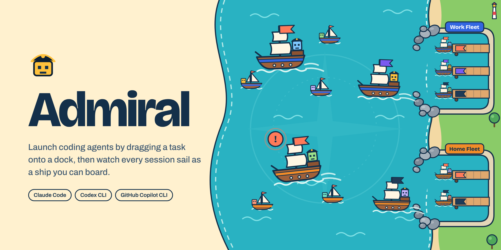

<picture>
  <source media="(prefers-color-scheme: dark)" srcset="docs/images/hero-dark.png">
  <source media="(prefers-color-scheme: light)" srcset="docs/images/hero-light.png">
  
</picture>

# Admiral

A visual dashboard for launching and watching coding-agent sessions (Claude Code, Codex CLI, GitHub Copilot CLI): your work queues on the left, a cartoon ocean of running sessions in the middle, and one marina per fleet on the right. Drag a task onto a harness's dock to start a session in the background, on Commodore or another skill; tap a ship to attach to its terminal.


## Requirements

- An Apple silicon Mac.
- At least one supported harness, installed and signed in: Claude Code, Codex CLI or GitHub Copilot CLI. `admiral setup` looks for them.
- `tmux` and `python3` (for the order sources). Homebrew installs both.

## Install

**Homebrew** (recommended):

```sh
brew install jbuffin/admiral/admiral
```

**curl script** (installs to `~/.local/bin`, no `sudo`; it warns when `tmux` or `python3` is missing but doesn't install them: `brew install tmux python@3.15`):

```sh
curl --proto '=https' --tlsv1.2 -fsSL https://github.com/jbuffin/admiral/releases/latest/download/install.sh | sh
```

`PREFIX=<dir>` changes where `bin/admiral` goes, and `ADMIRAL_VERSION=<x.y.z>` picks a release. The script checks the tarball against its SHA-256 file before it unpacks anything. If `~/.local/bin` isn't on your `PATH`, the script warns; add it, for example `export PATH="$HOME/.local/bin:$PATH"` in `~/.zshrc`.

The binary is ad-hoc signed, not notarized. Installing with Homebrew or the script leaves no quarantine attribute, so Gatekeeper doesn't stop it; a tarball downloaded in a browser would need `xattr -d com.apple.quarantine`.

## Get started

```sh
admiral setup            # find your harnesses and add your first fleet
admiral service install  # start Admiral at login, and restart it if it stops
```

`admiral service install` prints the "On other devices" URL with your token. Open that URL on your iPad or another device. `admiral service status` says whether the service is running and prints the URL again.

## Upgrade

With Homebrew, run `brew upgrade admiral`. With the curl script, run it again (the same command as above). Then restart the service so it runs the new version:

```sh
launchctl kickstart -k gui/$UID/dev.jasonbuffin.admiral
```

To switch from the curl script to Homebrew:

```sh
brew install jbuffin/admiral/admiral
$(brew --prefix)/bin/admiral service install   # points the LaunchAgent at the Homebrew binary
rm ~/.local/bin/admiral
```

## Uninstall

```sh
admiral service uninstall
brew uninstall admiral        # or, for a curl install: rm ~/.local/bin/admiral
```

This leaves `$ADMIRAL_HOME` (default `~/.admiral/`), which holds your config, token and state. Delete it to remove everything.

## Development

You need Go (version in `go.mod`), Node (version in `.nvmrc`) and tmux.

```sh
npm --prefix web ci                 # once per checkout
npm --prefix web exec playwright install webkit   # once, for the browser tests
make build                          # UI, then bin/admiral
bin/admiral --listen 127.0.0.1:7420 # prints the local URL and the URL for other devices
make lint                           # go vet and the TypeScript check
make test                           # Go and Vitest unit tests
make e2e                            # builds, then the server and browser tests
```

For UI work, run `bin/admiral --listen 127.0.0.1:7420` and then `npm --prefix web run dev`. Vite forwards `/api` and `/ws` to the server (set `ADMIRAL_SERVER` for another address).

For the code map, tests and releases, start from [`AGENTS.md`](AGENTS.md) and `docs/agents/`.

## More

- [Plugin guide](docs/plugins.md): write an order source.
- [Command line reference](docs/cli.md): every `admiral` command.
- [Personal builds](docs/personal-builds.md): build with the official harness logos.
- Admiral is released under the MIT License ([`LICENSE`](LICENSE)). Its bundled third-party code keeps its own licences, listed in `THIRD_PARTY_NOTICES`.
- Admiral is not affiliated with or endorsed by Anthropic, OpenAI or GitHub. Claude, Codex, Copilot and their logos are trademarks of their owners.
