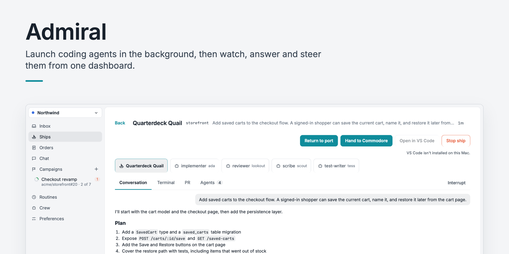
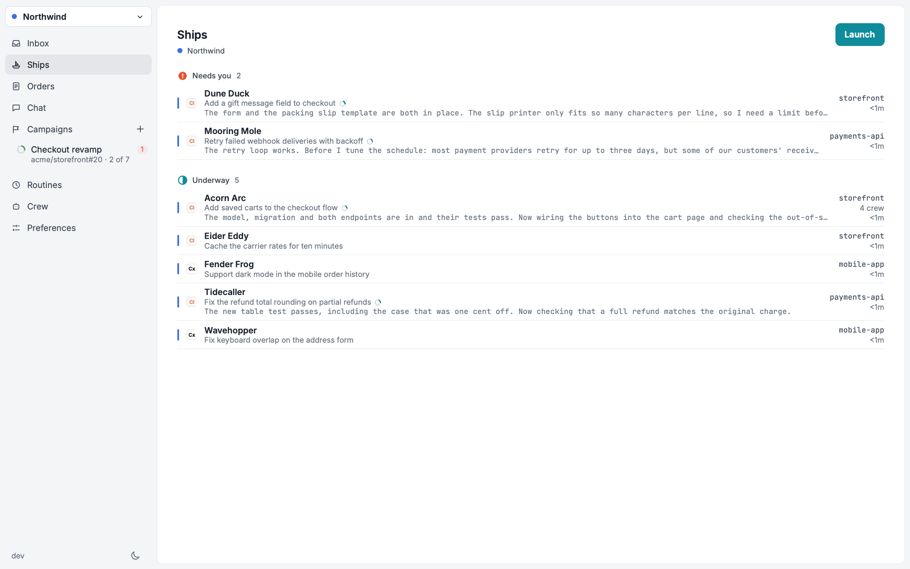
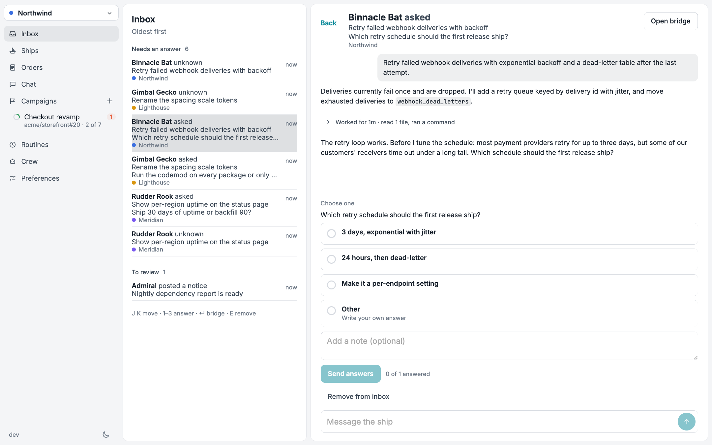
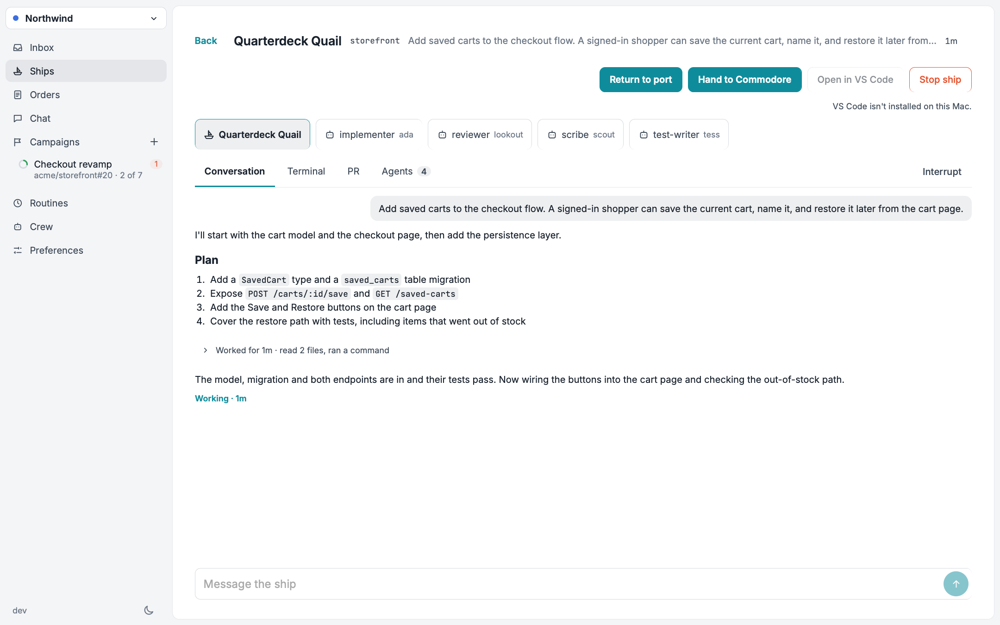
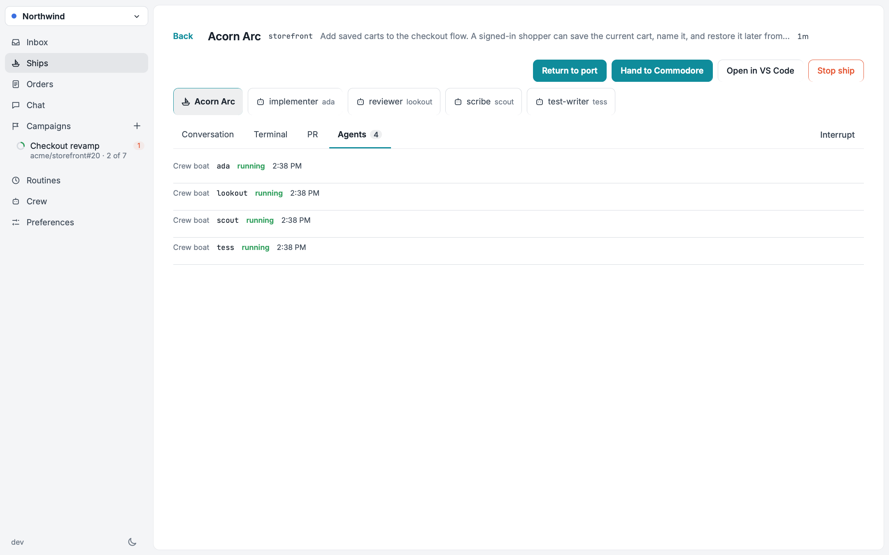
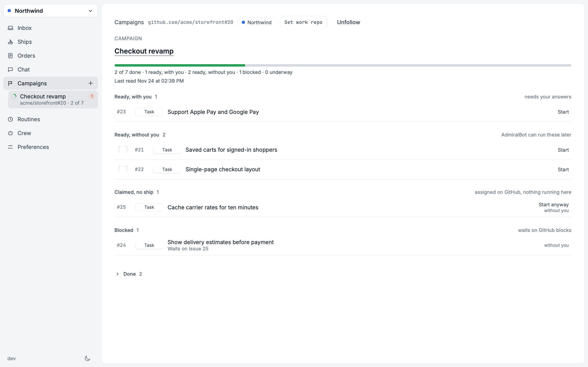

<picture>
  <source media="(prefers-color-scheme: dark)" srcset="docs/images/hero-dark.png">
  <source media="(prefers-color-scheme: light)" srcset="docs/images/hero-light.png">
  
</picture>

# Admiral

Admiral runs coding agents (Claude Code, Codex CLI, GitHub Copilot CLI) in the background on your Mac and gives you one dashboard to supervise them. Each running agent is a ship. You launch one, leave it working, and come back when it needs you: to answer a question, review a pull request or read what it did. It works from your Mac, iPad or phone.

Most agent tools stop at one agent in one window. Admiral is built for many at once: agent teams that pair a lead with a crew, orders you launch by hand, on a routine or through AdmiralBot, and a place where every question lands. Admiral itself runs on your Mac, next to your repos and your harness sign-ins.

## What you can do

### See every ship at once

Ships are grouped by what they need from you: the ones that need you come first, then the ones underway. Each row shows the harness, the repo and the ship's latest words. Fleets keep your work and personal setups apart.

<picture>
  <source media="(prefers-color-scheme: dark)" srcset="docs/images/ships-dark.png">
  <source media="(prefers-color-scheme: light)" srcset="docs/images/ships-light.png">
  
</picture>

### Answer from one inbox

When a ship asks a question or finishes work for review, it lands in the Inbox. Pick an option, add a note and send; the answer goes back to the ship's session. Keyboard shortcuts move through the list, and everything works with touch on an iPad.

<picture>
  <source media="(prefers-color-scheme: dark)" srcset="docs/images/inbox-dark.png">
  <source media="(prefers-color-scheme: light)" srcset="docs/images/inbox-light.png">
  
</picture>

### Read the conversation, not the scrollback

A ship's conversation shows what the agent said and did, with its plan, code and tool use laid out as formatted text. The Terminal tab is still there when you want to attach, and the PR tab follows the pull request the ship opened.

<picture>
  <source media="(prefers-color-scheme: dark)" srcset="docs/images/conversation-dark.png">
  <source media="(prefers-color-scheme: light)" srcset="docs/images/conversation-light.png">
  
</picture>

### Run a crew behind the lead

A ship can call on crew members, each with a role such as implementer, test writer, reviewer or scribe. The Agents tab lists the crew boats, subagents and background tasks working under the lead, so you can see who is doing what.

<picture>
  <source media="(prefers-color-scheme: dark)" srcset="docs/images/agents-dark.png">
  <source media="(prefers-color-scheme: light)" srcset="docs/images/agents-light.png">
  
</picture>

### Drive a software factory

A campaign follows a tracked issue and its sub-issues: it sorts them into ready, claimed, blocked and done, lets you start ships on the ready ones, and shows progress as they land. Routines launch work on a schedule, and autopilot lets a ship carry on without asking at every step. Admiral never merges on its own and never edits your issue tree; you merge, from the Inbox or on GitHub.

<picture>
  <source media="(prefers-color-scheme: dark)" srcset="docs/images/campaign-dark.png">
  <source media="(prefers-color-scheme: light)" srcset="docs/images/campaign-light.png">
  
</picture>

## Requirements

- An Apple silicon Mac with `tmux` (`brew install tmux`).
- At least one harness, installed and signed in: Claude Code, Codex CLI or GitHub Copilot CLI.
- Optional: the [Commodore](https://github.com/jbuffin/skills) skill, the default skill for a launch. Admiral offers to install it in `admiral setup` and in the launch dialog. To do it yourself, run `npx skills add jbuffin/skills`, or in Claude Code install the `jasonbuffin@jbuffinskills` plugin. Without it, you launch with another skill or none.

## Install

```sh
brew install jbuffin/admiral/admiral
```

No Homebrew? Use the [install script](docs/install.md#install-script).

## Get started

```sh
admiral setup            # find your harnesses and add your first fleet
admiral service install  # run Admiral at login and keep it running
```

Open <http://127.0.0.1:7420> on your Mac. To add an iPad or phone, run `admiral pair` and open the pairing URL it prints on that device; the code lasts five minutes.

`admiral service status` says whether the service is running. Logs go to `~/.admiral/logs/admiral.log`.

## Upgrade

```sh
brew upgrade admiral
launchctl kickstart -k gui/$UID/dev.jasonbuffin.admiral   # restart the service on the new version
```

To uninstall, see [Install, upgrade and uninstall](docs/install.md#uninstall).

## Contributing

Bugs and ideas go in [GitHub Issues](https://github.com/jbuffin/admiral/issues). To build from source you need Go (version in `go.mod`), Node (version in `.nvmrc`) and tmux:

```sh
npm --prefix web ci                               # once per checkout
npm --prefix web exec playwright install webkit   # once, for the browser tests
make build                                        # the UI, then bin/admiral
bin/admiral --listen 127.0.0.1:7420
```

For UI work, keep that server running and start Vite with `npm --prefix web run dev`.

Before you open a pull request, run `make check` (build, lint and unit tests; what PR CI runs) and `make e2e` (the server and browser tests, which CI doesn't run), and paste the `make e2e` result into the PR's `## E2E evidence` section. [`AGENTS.md`](AGENTS.md) covers the rest: the glossary, the code map, which tests to write and how to run them.

## More

- [Command line reference](docs/cli.md): every `admiral` command.
- [Plugin guide](docs/plugins.md): write an order source plugin.
- [Personal builds](docs/personal-builds.md): build with the official harness logos.

Admiral is released under the MIT License ([`LICENSE`](LICENSE)); its bundled third-party code keeps its own licences, listed in `THIRD_PARTY_NOTICES`. Admiral is not affiliated with or endorsed by Anthropic, OpenAI or GitHub. Claude, Codex, Copilot and their logos are trademarks of their owners.
