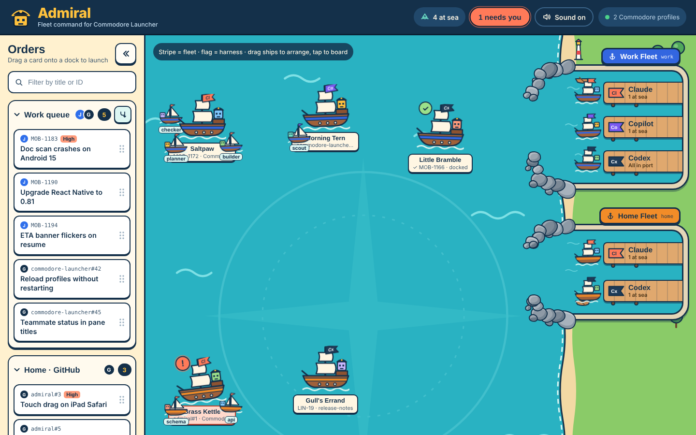

# Admiral

A visual dashboard for launching and watching coding-agent sessions (Claude Code, Codex CLI, GitHub Copilot CLI): your work queues on the left, a cartoon ocean of running sessions in the middle, and one marina per fleet on the right. Drag a task onto a harness's dock to start a session in the background, on Commodore or another skill; tap a ship to attach to its terminal.

The designs are done and the MVP build has started.



## Layout

- `designs/`: the clickable prototype, screenshots, design tokens, SVG assets and source design files. Start with `designs/README.md`.
- [Admiral MVP spec](https://github.com/jbuffin/admiral/issues/45): what the MVP does, as user stories, implementation decisions and testing decisions.
- `docs/architecture.md`: an early proposal for the build, superseded by the spec and the ADRs.
- `docs/adr/`: decisions.
- `GLOSSARY.md`: the words Admiral uses.
- `cmd/admiral/`, `internal/`: the Go server and CLI. `internal/auth` is access control, `internal/server` is HTTP and WebSocket, `internal/home` finds `$ADMIRAL_HOME`, `internal/config` loads, validates, watches and writes `$ADMIRAL_HOME/config.json`. `internal/sessionhost` is the one tmux control-mode connection on `$ADMIRAL_HOME/tmux.sock` (it re-reads the sessions about every half second, and a global `alert-bell` hook stamps bells), `internal/launcher` creates ships (names, hook bundle in `$ADMIRAL_HOME/harness/`, command lines), `internal/state` is `$ADMIRAL_HOME/state.json` (ship positions, each dock's last directory), `internal/ships` serves `GET`/`POST /api/ships`, `PUT /api/ships/<session>/position`, `POST /api/ships/<session>/input-seen` (a browser sent input: clears needs you), `POST /api/ships/<session>/dismiss` (ends an anchored ship) and the WebSocket `ships` message. A ship's `status` is `underway`, `needs_you`, `anchored` (with `exit_code` or `exit_signal`) or `sailing_off` (exit 0, session killed after 3 s); hooks, a Codex bell and the 10 s no-hook rule decide needs you, and `HiddenOrders` lists the orders ships hide.
- `web/`: the Preact UI. `web/embed.go` embeds the built `web/dist` into the binary.
- `packaging/`: the Homebrew formula, the curl install script and the notices generator. `make release` builds the tarball.
- `e2e/`: server tests that run the real binary.

## Install

Admiral runs on Apple silicon Macs only. It needs `tmux` and `python3` (for the Orders plugins).

**Homebrew** (installs `tmux` and `python@3.15` with it):

```sh
brew install jbuffin/admiral/admiral
```

**curl script** (installs to `~/.local/bin`, no `sudo`; it warns when `tmux` or `python3` is missing but doesn't install them: `brew install tmux python@3.15`):

```sh
curl -fsSL https://github.com/jbuffin/admiral/releases/latest/download/install.sh | sh
```

`PREFIX=<dir>` changes where `bin/admiral` goes, and `ADMIRAL_VERSION=<x.y.z>` picks a release. The script checks the tarball against its SHA-256 file before it unpacks anything.

Then:

```sh
admiral setup            # find your harnesses and add your first fleet
admiral service install  # start Admiral at login, and restart it if it stops
```

`admiral service install` writes the LaunchAgent `~/Library/LaunchAgents/dev.jasonbuffin.admiral.plist`, points it at the stable path (`$(brew --prefix)/bin/admiral` under Homebrew, never the versioned Cellar path), gives ships the `PATH` of your login shell, logs to `$ADMIRAL_HOME/logs/admiral.log` and prints the "On other devices" URL with the token. Open that URL on your iPad. `admiral service status` says whether the job is installed and loaded and prints the URL again; `admiral service uninstall` removes it. After `brew upgrade admiral`, restart the service with `launchctl kickstart -k gui/$UID/dev.jasonbuffin.admiral`. `admiral --version` prints the version and commit.

The binary is ad-hoc signed, not notarized. Installing with Homebrew or the script leaves no quarantine attribute, so Gatekeeper doesn't stop it; a tarball downloaded in a browser would need `xattr -d com.apple.quarantine`.

### Idle memory

One fleet, the Orders source, no ships, on an M-series Mac (macOS 27, Go 1.26, tmux 3.7c, python 3.14), resident set size from `ps -o rss`:

| process | RSS |
| --- | --- |
| `admiral` | about 16 MB |
| the freeform plugin (`python3 plugin.py`) | about 19 MB |
| Admiral's tmux server and its control client | about 4 MB and 5 MB |

Each ship adds its harness, and a pane in tmux.

### Personal builds

A build from your own checkout can carry the official harness logos: put them in `web/logos/official/` (see "Logos" below) and run `make build`. `make release` refuses to run while that folder holds files, so a shared tarball only ever has the lettered placeholders. Admiral is not affiliated with or endorsed by Anthropic, OpenAI or GitHub. Claude, Codex, Copilot and their logos are trademarks of their owners.

### Cutting a release

1. Tag the commit, `git tag v0.1.0`, with no files in `web/logos/official/` and a clean tree.
2. Run `npm --prefix web ci` and `make release`. It rebuilds the UI from clean, builds `bin/admiral` for darwin/arm64 stamped with the tag (`VERSION=x.y.z` overrides `git describe`) and the commit, checks `codesign -v`, and writes `dist/admiral-<version>-darwin-arm64.tar.gz` and `.tar.gz.sha256`. The tarball holds `admiral`, `THIRD_PARTY_NOTICES` and a reference copy of `plugins/freeform/`. Never `strip` the binary: that breaks its signature.
3. Create the GitHub release `v<version>` and upload the tarball, the `.sha256` file and `packaging/install.sh`.
4. In the tap repo `jbuffin/homebrew-admiral`, copy `packaging/homebrew/admiral.rb` to `Formula/admiral.rb`, replace `VERSION` and `SHA256_OF_THE_TARBALL` with the release's, then run `brew style` and `brew audit --strict --online jbuffin/admiral/admiral`.

There is no `LICENSE` file yet.

## Development

You need Go (version in `go.mod`), Node (version in `.nvmrc`) and tmux.

```sh
npm --prefix web ci                 # once per checkout
npm --prefix web exec playwright install webkit   # once, for the browser tests
make build                          # UI, then bin/admiral
bin/admiral --listen 127.0.0.1:7420 # prints the local URL and the URL for other devices
make lint                           # go vet and the TypeScript check
make test                           # Go and Vitest unit tests
make e2e                            # builds, then the server and browser tests
```

Admiral keeps its data in `$ADMIRAL_HOME` (default `~/.admiral/`). Every test starts the binary with a fresh temporary one on a free port, so tests never touch yours.

Tests sit at two seams. `e2e/` (Go) starts `bin/admiral` and drives it over HTTP and WebSocket. `web/e2e/` (Playwright, WebKit) loads the page at iPad landscape, iPad portrait and desktop sizes. Vitest covers pure UI state logic only.

Tests that launch ships use the fake harnesses in `e2e/fakeharness/` (`claude`, `codex` and `copilot` are symlinks to `fake.sh`). A test puts one as the `executable` of a fleet and passes two variables in the fleet's `env`: `FAKE_RECORD_DIR` (where to record) and `FAKE_CUE` (an optional cue file). Started in a ship's pane, the fake writes `<FAKE_RECORD_DIR>/<tmux session>/` with `harness`, `argv` (each argument followed by a NUL byte), `env` (one `NAME=value` per line), `cwd`, `name` (the `@admiral-name` option as read at start), `options` (all session options at start) and last an empty `recorded` file to wait for. Then it runs the cue file, one cue per line: `hook <needs_you|working>` runs `tmux set -p @admiral-state <state>`, `bell` rings the bell, `sleep <n>` waits n seconds, `exit <n>` exits with status n, `lines <n>` prints n numbered lines (`line 0001`…) in cycling SGR colours, `altscreen` switches to the alternate screen with application cursor keys and bracketed paste on and prints `ALT SCREEN`, and `wait <name>` blocks until the file `<tmux session>/<name>` exists in the recording directory. When the cues end it puts the terminal in raw mode (`stty raw -echo`), creates `cues-done` and stays running unless a cue exited; from then on it records every byte it reads from the terminal, exactly as received, in `stdin` (a test sends input only after `cues-done`). The same protocol is in the header of `fake.sh`. Tests that run tmux set `TMUX_TMPDIR` to a temporary directory and talk to tmux only with `tmux -S <home>/tmux.sock`.

The server tests that connect through the Mac's own LAN address skip, with a message, when that address doesn't answer. They always run in CI.

For UI work, run `bin/admiral --listen 127.0.0.1:7420` and then `npm --prefix web run dev`. Vite forwards `/api` and `/ws` to the server (set `ADMIRAL_SERVER` for another address).

### The bridge protocol

The bridge is the terminal a browser opens on a ship. Each ship has its own WebSocket, `GET /ws/bridge/<the ship's tmux session name>`, behind the same token and Origin checks as `/ws`. A session that is not a current ship (gone, a strict prefix of a live one, `_admiral`) is refused at the handshake with 404. Admiral attaches one tmux control client per watched ship, shared by every browser on it. It starts with the first browser, and detaches 30 s after the last one leaves (`ADMIRAL_BRIDGE_IDLE` sets another Go duration for tests); the pane keeps its last size. Every tmux command the bridge sends targets `=<session>:` or a pane id, never a bare name.

Browser to server, JSON text frames:

| message | meaning |
| --- | --- |
| `{"type":"join","cols":C,"rows":R}` | First message. The browser's size; it becomes the active browser. |
| `{"type":"resize","cols":C,"rows":R}` | A new size. The browser becomes active and the pane takes its size. |
| `{"type":"active"}` | The browser was tapped, clicked or typed in. It sets the pane to the size it last reported. |
| `{"type":"visible","visible":false}` | The tab is hidden: it stops receiving output and can't become active. `true` makes it rejoin like a joining browser. |
| `{"type":"input","data":"..."}` | Bytes for the pane, exactly as given. Each input clears needs you first, then goes out as `send-keys -H`. |

Server to browser:

| message | meaning |
| --- | --- |
| `{"type":"join","screen","scrollback","cursor":{"x","y","visible"},"modes":{"alternate","application_cursor","bracketed_paste","mouse"},"size":{"cols","rows"},"ship":{"status","exit_code","exit_signal"}}` | Sent after `join`, and again after `visible: true`. `screen` and `scrollback` (at most 2,000 lines) come from `capture-pane -p -e`, with SGR colours, lines joined by `\n`. A pane in the alternate screen, or with no history yet, has an empty `scrollback`. Output frames follow with nothing missing or repeated. |
| binary frame | The pane's output bytes, decoded from `%output`. Write them to xterm.js as bytes: tmux can split a UTF-8 character across two frames. |
| `{"type":"size","cols","rows"}` | The pane's size changed. The browsers that didn't set it resize xterm.js to this grid and scale it, never reflowing. |
| `{"type":"ship","status","exit_code","exit_signal"}` | The ship's status changed. (Not `status`: that is the ship's own field.) |
| `{"type":"refused","reason":"anchored"}` | Input to a ship that has exited. The reason is the ship's status. |

The page itself takes the ship's status from the main `/ws` socket; the `ship` and `refused` messages are for other clients of the bridge.

An order's first line rides the ship as `title` (the eleventh session option, `@admiral-title`, set at launch with control characters, bidi controls and line separators dropped; empty for a launch with no source).

When the server goes away an open bridge keeps its last screen, dims, says "Reconnecting…", disables input and queues nothing. The page's own socket and the bridge retry after 1 s, doubling to 10 s, and the bridge rejoins as a new browser. Browsers don't expose why a WebSocket handshake failed, so each failed reconnect asks `GET /api/ships`: a 401 stops every retry and shows "Open the URL Admiral printed"; a ship missing from the list closes the bridge.

The terminal is xterm.js (MIT) with the fit and WebGL addons, loaded when the first bridge opens.

### The command line

`admiral` with no command starts the server. On a terminal with no fleets it first asks whether to run setup (not under launchd, where stdin is not a terminal). The other commands work on `$ADMIRAL_HOME`. Exit codes: 0 ok, 1 error, 2 usage (unknown command, bad flags, `setup --yes` without `--answers`).

| command | what it does |
| --- | --- |
| `admiral setup [--answers <file> --yes] [--dry-run]` | Finds your harnesses, wrappers (`claude-work`...), the names of `~/.claude*`, `~/.codex*` and `~/.copilot*` (never what is inside them) and folders under `~` that hold git checkouts, asks for each fleet, shows the change as a diff and asks before writing. It only adds or updates: fleets it isn't told about and top-level keys it doesn't know stay as they are. Interactively, a re-run lists the fleets already in the file, takes each default from the fleet you name, offers a wrapper named `<harness>-<key>` as the executable, and ends on an empty key. If `config.json` changes while setup waits to write, it plans again on the new file and asks again. It refuses a fleet that shares an identity directory with another fleet for the same harness. |
| `admiral fleet list \| add \| edit \| check` | `add <key> --name N` and `edit <key>` take `--color`, `--harness`, `--executable <harness>=<path>`, `--arg <harness>=<arg>`, `--env <harness>=<NAME>=<value>`, `--unset-env <harness>=<NAME>`, `--search-root` and `--remove-search-root`; every flag may repeat, and the key comes first. On `edit`, the `--arg` values for a harness replace its arguments. `~` is stored as typed. `check` resolves each executable without running it and exits 1 when one is missing. |
| `admiral config show \| validate \| edit` | `edit` opens a copy in `$EDITOR` (`vi` without one) and saves it only if it loads, so it also fixes a file that is invalid now. |
| `admiral token rotate [--port N]` | Writes a new token and prints the new "On other devices" URL. A running server notices and signs out every device that isn't on this Mac, dashboard and bridge alike. `--port` (default 7420) is the port of the URL and of the server it looks for (`GET /api/ships` carries a `home` field, a hash of `ADMIRAL_HOME`, which the CLI compares); a server on that port that serves another `ADMIRAL_HOME` doesn't count, and the command says there is no running server for this home. |
| `admiral ships [--port N] [--names]` | Lists ships (`NAME SESSION FLEET HARNESS STATUS REPO`, tab-separated) as the running server on `--port` sees them, if it serves this `ADMIRAL_HOME`. Otherwise it reads tmux and says so on the first line. `--names` prints display names only. |
| `admiral attach <ship>` | Attaches this terminal to the ship's tmux session (`Ctrl-b d` detaches), by display name or session name. Read-only for an anchored ship. `_admiral` and `_setup` are refused. |
| `admiral completion zsh \| bash` | Completes ship names for `attach`. |

The answers file for `setup --answers` is JSON holding the same `fleets` object as `config.json`, in the order the fleets should have:

```json
{"fleets": {"work": {"name": "Work", "search_roots": ["~/code"],
                     "claude": {"env": {"CLAUDE_CONFIG_DIR": "~/.claude-work"}},
                     "codex": {}}}}
```

An `executable` left out is looked up on `PATH` (and `/opt/homebrew/bin`, `/usr/local/bin`, `~/.local/bin`) and written as the absolute path found, without following symlinks. The identity variable (`CLAUDE_CONFIG_DIR`, `CODEX_HOME`, `COPILOT_HOME`) is always written, with the harness's default directory when the file leaves it out; two fleets that leave it out share that default and are refused.

### The setup terminal

Tapping the "Set up a fleet" marina or the header's fleet count opens `admiral setup` in a terminal over open water. It runs in the tmux session `_setup` on Admiral's socket (never in `ships`, never a ship) and uses the bridge's terminal, so several browsers can share it and a dropped connection rejoins. `POST /api/setup` starts it or leaves the running one alone; `GET /api/setup` says whether it runs. The bridge accepts `/ws/bridge/_setup` while the session exists. The terminal closes when the session ends, whether setup wrote the file or not, and the page then re-reads `/api/config`; a change to `config.json` alone never closes it.

### Logos

The flags draw a logo `<symbol>` by id (`logo-claude`, `logo-copilot`, `logo-codex`). Without official files the build uses lettered placeholders (Cl, Co, Cx). For a personal build, put the official logo files in `web/logos/official/` as `claude.svg`, `copilot.svg` and `codex.svg` (the folder is gitignored) and rebuild; they replace the placeholders under the same ids. Each file holds the mark only, on a transparent background, with a `viewBox`. Admiral draws each harness's field from the vendors' usage rules (Claude ivory, Copilot dark, Codex white) and centres the mark with clear space. A harness Admiral doesn't know draws the `logo-unknown` placeholder, a "?" on a plain field. Never redraw a vendor logo or commit these files.
